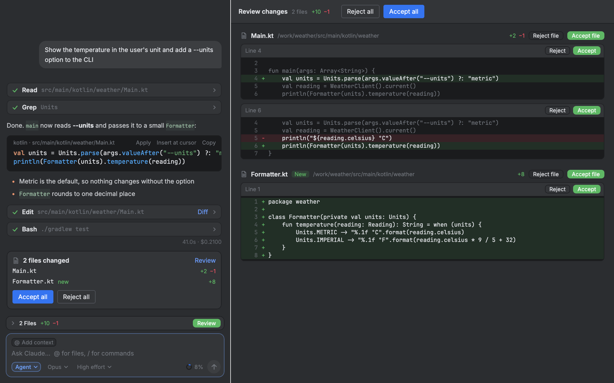
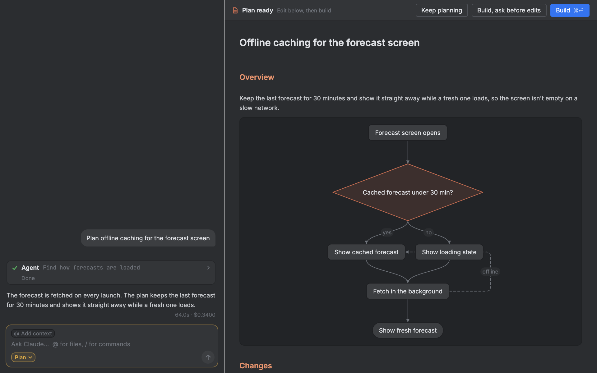
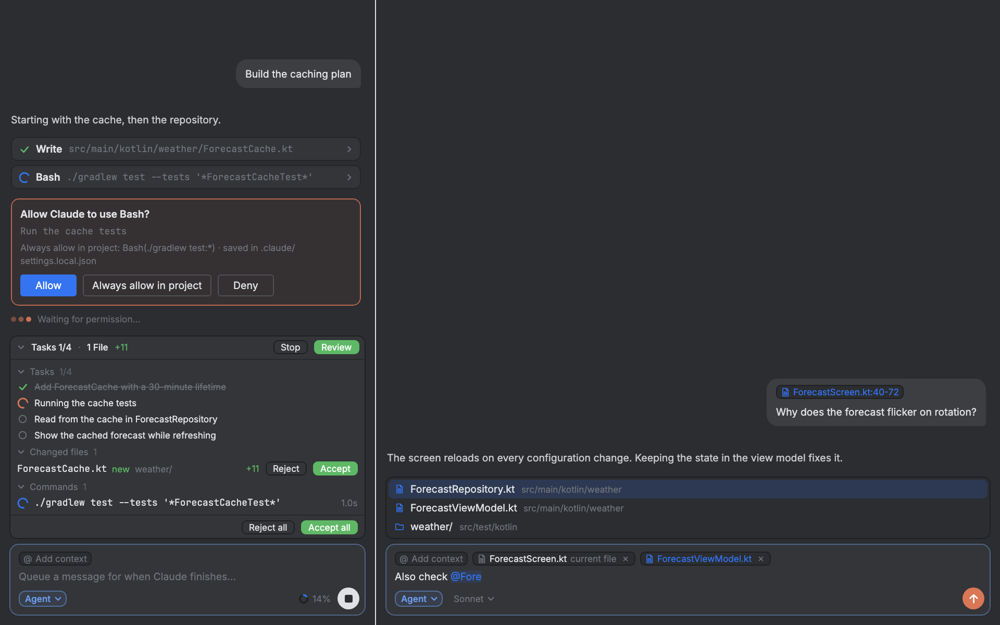
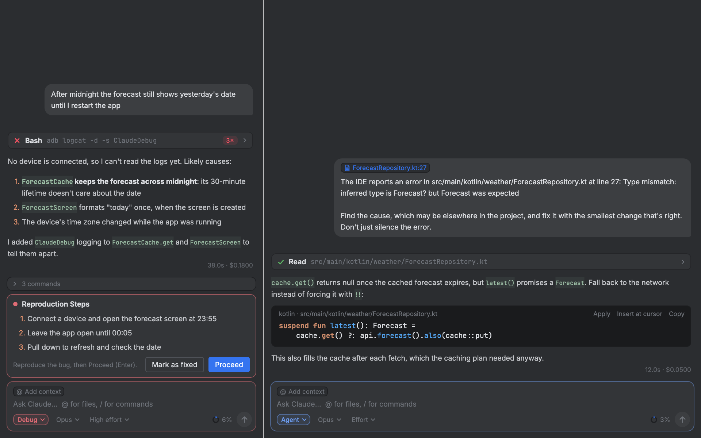
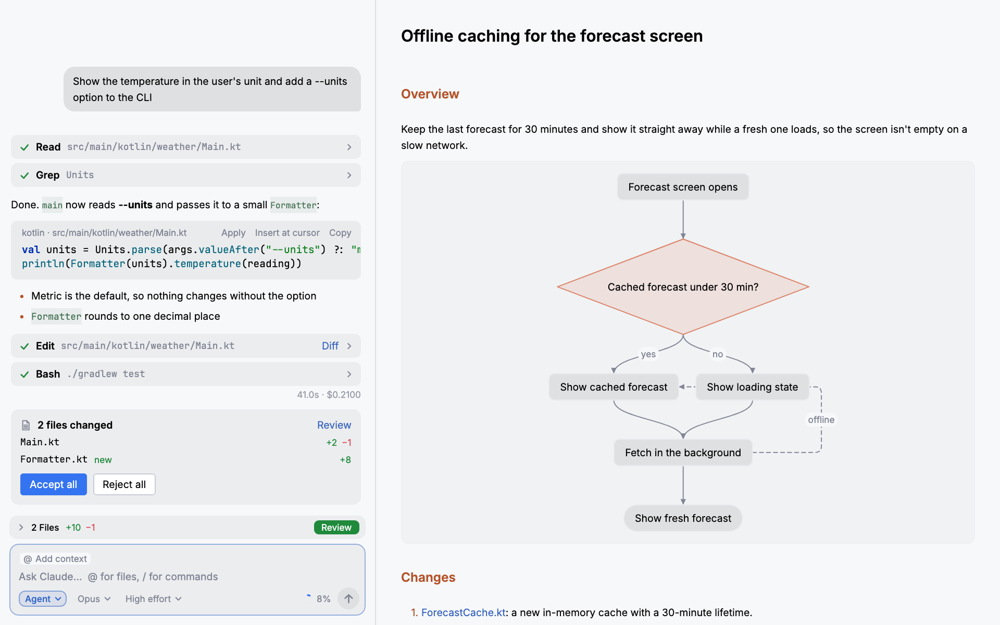

# Claude Chat Suite

A Cursor-style chat for [Claude Code](https://docs.claude.com/en/docs/claude-code) in Android Studio, IntelliJ IDEA
and the other JetBrains IDEs. Not made by or affiliated with Anthropic. The plugin
runs your local `claude` CLI in stream-json mode and draws the conversation in a tool window, so your sign-in,
`CLAUDE.md` files, memory, skills and MCP servers all apply as they do in the terminal.

**Highlights**

- Chats in tabs, with history (including chats started with `claude` in a terminal), slash commands, `@` file
  context, screenshots, a model picker and queued messages.
- Modes as in Cursor, each in its own color: Agent, Agent · auto-edit, Plan, Ask (read-only), Debug (logs and
  reproduction steps) and Auto.
- Plans open as documents in an editor tab, with Mermaid flowcharts, an editable to-do list and **Build**.
- Every change Claude makes can be reviewed per change, in a **Claude Changes** tab and right in the editor, with
  Accept / Reject, plus checkpoints to undo a whole turn.
- **Edit with Claude…** (Cursor's Cmd+K) on selected code in the editor.
- Sign in from the chat when Claude Code isn't signed in.



| Plans with flowcharts | Tasks, changes and permission prompts |
|---|---|
|  |  |
| **Debug mode, and Fix with Claude with Apply** | **Light theme** |
|  |  |

## Getting started

1. Install the Claude Code CLI 2.1 or later:
   - macOS and Linux: `curl -fsSL https://claude.ai/install.sh | bash`
   - Windows (PowerShell): `irm https://claude.ai/install.ps1 | iex`
   - or with npm: `npm install -g @anthropic-ai/claude-code`
2. Install the plugin (below) and open the **Claude** tool window on the right.
3. If Claude Code isn't signed in yet, sign in from the chat.
4. Type a message. Pick the mode under the message box; **Cmd+Shift+J** (Ctrl+Shift+; on Windows and Linux) jumps to
   the chat with the selected code attached.
5. Options are in **Settings → Tools → Claude Chat Suite**: the CLI's path if it isn't on the `PATH`, the default model
   and mode, notifications, MCP servers and more.

## Requirements

- Android Studio, IntelliJ IDEA or another JetBrains IDE, 2026.2.3 (build 262.10968) or later, on macOS or Windows.
- Claude Code CLI 2.1 or later, installed and on the `PATH` (or set its path in Settings → Tools → Claude Chat Suite).
  Signing in can be done from the chat.

## Install

1. From [JetBrains Marketplace](https://plugins.jetbrains.com/plugin/36105-claude-chat-suite): **Settings → Plugins →
   Marketplace**, search for Claude Chat Suite, install.
2. Or get `ClaudeChat-<version>.zip` from [GitHub Releases](https://github.com/Jemshi101/ClaudeChat/releases) (or build
   it, below), then **Settings → Plugins → ⚙ → Install Plugin from Disk…**, pick the zip, restart.
3. Open the **Claude** tool window on the right.

To update, install a zip with a higher version the same way. Coming from a version before 2.38.0, uninstall the old
Claude Chat first: the plugin's ID changed from `dev.claudechat` to `in.bleuphoenix.claudechat`, so the IDE sees a new
plugin. Settings, MCP keys, shortcuts and chats carry over.

## Build from source

Needs a local Android Studio 2026.2, which the plugin compiles against, and a Java to start Gradle (Studio's bundled
one will do). The code compiles with JDK 21; Gradle uses an installed one or downloads it.

```bash
git clone https://github.com/Jemshi101/ClaudeChat.git
cd ClaudeChat
./gradlew buildPlugin        # → build/distributions/ClaudeChat-<version>.zip
```

On Windows, use `gradlew.bat` and point the build at Studio's install folder, which isn't the macOS default in
`gradle.properties`. If `java` isn't on the `PATH`, start Gradle with Studio's bundled JDK:

```bat
set JAVA_HOME=C:\Program Files\Android\Android Studio\jbr
gradlew.bat buildPlugin -PandroidStudioPath="C:\Program Files\Android\Android Studio"
```

To avoid passing it every time, put `androidStudioPath=...` in `%USERPROFILE%\.gradle\gradle.properties` (or
`~/.gradle/gradle.properties` on macOS), which overrides the project's value. In that file, write backslashes as
`\\` or use forward slashes.

Tests run on macOS: they start a fake CLI through `/bin/sh` and `/usr/bin/python3`. Building, `verifyPlugin` and
`runIde` work on both.

### Making a release

1. Bump `version` in `build.gradle.kts` (the IDE only updates to a higher version) and add a line to `changeNotes`.
2. `./gradlew test buildPlugin verifyPlugin` — all tests pass and the verifier reports **Compatible**.
3. Commit as `<version>: <what changed>` and push; share the zip from `build/distributions/`.
4. Tag it `v<version>` and attach the zip to a GitHub release.
5. Publish to JetBrains Marketplace (below).

### Publishing to JetBrains Marketplace

The listing shows the latest 8 entries of `changeNotes`, with a link to GitHub Releases for the rest.

**First version:** JetBrains requires the first upload to be made by hand: at
[plugins.jetbrains.com](https://plugins.jetbrains.com) → your profile → **Upload plugin**, pick the zip, license
**GPL-3.0**, source code `https://github.com/Jemshi101/ClaudeChat`. JetBrains reviews it before it's listed.

**Later versions** publish from Gradle. The secrets come from environment variables, never the repo:

```bash
export PUBLISH_TOKEN=…                        # plugins.jetbrains.com → profile → My Tokens
# Optional, signs the plugin (Marketplace also signs it):
export CERTIFICATE_CHAIN_FILE=~/.bleuphoenix-signing/chain.crt
export PRIVATE_KEY_FILE=~/.bleuphoenix-signing/private.pem
export PRIVATE_KEY_PASSWORD=…
./gradlew publishPlugin
```

To make a signing certificate once, outside the repo:

```bash
mkdir -p ~/.bleuphoenix-signing && cd ~/.bleuphoenix-signing
openssl genpkey -aes-256-cbc -algorithm RSA -out private.pem -pkeyopt rsa_keygen_bits:4096
openssl req -key private.pem -new -x509 -days 3650 -out chain.crt -subj "/CN=BleuPhoenix"
```

## License

GPL-3.0 (see [LICENSE](LICENSE)), with one additional term under its section 7(b): a fork or other work based on
this code must keep the attribution in [NOTICE](NOTICE) ("Based on Claude Chat Suite by Jemsheer K D (BleuPhoenix)") in its
NOTICE or README, and in its description or About text.

"Claude" is a trademark of Anthropic, PBC; this project isn't made by or affiliated with Anthropic.

## Use

- **Claude** tool window (right sidebar). **+** starts another chat; each chat is its own CLI session in the
  project folder, and its tab is named after it. Each tab has its own **×** (closing a chat that's still working asks
  first; closing the last one starts a new chat); the ⋮ menu also has Close Chat and Close Other Chats.
- **History** (clock button, or "Recent chats" on the welcome screen): past chats in this project, including ones
  started with `claude` in a terminal. Open one to read it and continue where it left off; hover to rename (the
  name shows in the CLI too) or delete.
- **Signing in:** if Claude Code isn't signed in on this computer (the CLI says "Not logged in"), or you type
  `/login`, the chat shows a **Sign in** card. It runs `claude auth login`, which opens the browser; if the page shows
  a code, paste it into the card. Once signed in, the message that failed is sent again. The CLI's own `/login`
  can't run inside a chat.
- **Enter** sends, **Shift+Enter** adds a line, **Stop** interrupts the current turn. Sending while Claude works
  queues the message above the box (click to edit it, × to remove it); queued messages go in order as Claude
  finishes, and Stop puts them back in the box.
- **Focus Claude Chat:** Cmd+Shift+J (macOS) or Ctrl+Shift+; puts the caret in the message box, adding the
  editor's selected lines first. Rebind it under Settings → Keymap.
- **Activity strip** above the message box ("› Tasks 2/5 · 1 running · 3 Files +42 −7"; Cmd+Alt+J on macOS,
  Ctrl+Alt+' elsewhere, opens or closes it):
  - **Tasks:** Claude's to-do list as it works.
  - **Background:** shell commands and agents Claude runs in the background, with time, activity, Output (a
    command's log) and Stop.
  - **Changed files:** this chat's changes waiting for review, with Reject / Accept, Reject all / Accept all and
    Review; click a file to open it at its change.
  - **Commands:** the chat's recent terminal commands with status and duration; click one to jump to its card.
  - Click a section's heading to fold or unfold it; folded sections stay folded in every chat.

  While Claude works, the round button is Stop, or Send while something is typed.
- **While Claude works:** a typed message can wait for the task to finish (**Queue**, Enter), reach Claude at its
  next step without stopping it (**Send now**, Alt+Enter), or interrupt the task and go first (**Stop & send**,
  Cmd/Ctrl+Enter). Queued messages have Send now and Stop & send too.
- **Slash commands:** type `/` for the CLI's commands and skills (`/compact`, `/context`, `/clear`, `/code-review`,
  …). Enter or Tab completes the name; Enter on a full name sends it. `/` later in a message (after a space) lists
  them too and completes the name in place: the CLI only runs a command that starts the message, but Claude reads a
  skill named later on and runs it (built-in commands such as `/clear` only work at the start). Commands are shown in
  orange and files (`@path` and file chips) in the link color, as you type and in sent messages.
- **Model picker** next to the mode selector: the models your CLI offers. The choice applies to the chat right
  away and to new chats.
- **Effort picker** next to it: how much Claude thinks before answering (Low, Medium, High, Extra high, Max, or
  Default for Claude Code's own setting), listing the levels the model supports. It applies from the next reply and
  to new chats; the default is also in Settings. Edit with Claude, Apply and commit messages keep the CLI default.
- **Permission prompts:** Allow, Deny, and "Allow always" when the CLI suggests a rule. Shell rules are saved in
  `.claude/settings.local.json` at the repository root. Edits have **Review changes** to see the diff first.
- **Context:** chips above the message box. The current editor file is offered as a pointer (✕ leaves it out);
  type `@` (or click **@ Add context**) to search project files and folders; paste (Cmd+V) screenshots and files, or
  drag them anywhere onto the chat from the project tree, editor tabs, Finder or Explorer; **Ask Claude About Selection** adds the selected lines. Files are sent as `@path` mentions, which the
  CLI expands into their content; images go as image blocks.
- **Read-only commands:** shell commands that only read files inside the project (`grep`, `sed -n`, `cat`, `ls`,
  `find`, `git log`, `dart analyze`, Python scripts that only read…, with `cd`, pipes, `for` loops and heredocs) run
  without asking, and so do copies into the temp folder (`cp file /tmp/x`) and Claude's Read, Glob and Grep on files
  there. Reading elsewhere outside the project, other writes, or any other program still asks. Settings → Tools → Claude Chat Suite.
- **Notifications:** when Claude finishes, needs permission, asks a question or has a plan ready while you're
  elsewhere (another app, another tab, the Claude window closed): an IDE notification, shown in the system's
  notification center when Android Studio is in the background, with Open Chat to jump to it. Settings → Tools →
  Claude Chat Suite → Notifications.
- **Cursor's commands:** commands in `~/.cursor/commands` are copied to Claude Code's (`~/.claude/commands`) when a
  chat starts, so they're under `/`, and to Antigravity's global workflows when it's installed. A name Claude Code
  already uses gets `-flow`. Off switch in Settings → Tools → Claude Chat Suite.
- **MCP servers:** Settings → Tools → Claude Chat Suite → MCP Servers adds, edits and removes the servers Claude Code
  uses (via `claude mcp`), with their status. API keys go in the system keychain; the config holds
  `${CLAUDE_CHAT_MCP_<NAME>}` instead, which chats fill in (set that variable to use the server from a terminal).
  **MCP** under the message box shows whether this chat's servers connected.
- **MCP sign-in:** servers that use OAuth sign in from the MCP Servers page (**Sign In** / **Sign Out**, through
  `claude mcp login` and `logout`) or from the chat: when **MCP** under the message box shows a server needing sign-in
  or one that failed, click it for **Sign in to …** (opens the browser; the chat connects once you're done) or
  **Reconnect …**. The server dialog's **OAuth Sign-In** section sets a pre-registered client ID and secret (the
  secret is kept by Claude Code, passed in `MCP_CLIENT_SECRET`, never on the command line), scopes, a fixed callback
  port and the authorization server's metadata URL.
- **Claude Code Settings:** Settings → Tools → Claude Chat Suite → Claude Code Settings edits the permission rules
  (Allow, Ask, Deny) and environment variables in Claude Code's own settings files: this project only for you
  (`.claude/settings.local.json`), this project shared (`.claude/settings.json`), or all projects
  (`~/.claude/settings.json`). Changes are written on Apply, keeping the files' other settings; **Open in Editor**
  shows the whole file. A file that isn't valid JSON is shown but not changed.
- **Mode selector** under the message box (or Shift+Tab): Agent, Agent · auto-edit, Plan, Ask, Debug, Auto. Each has
  its own color (blue, teal, amber, green, red, violet) on the chip and the message box's border, so the mode shows at
  a glance. **Ask** is read-only, as in Cursor: Claude reads and searches the code to answer, and an edit or a command
  that would need approval is declined for you (the CLI runs in its normal mode; the chat enforces this).
- **Debug mode**, as in Cursor: describe a bug and Claude lists what could cause it, adds logging tagged `ClaudeDebug`
  (logcat in Android code, a `.claude/debug-*.log` file for code that runs on the computer) and gives reproduction
  steps, which show in a bar above the message box. Reproduce the bug and press **Proceed** (or Enter in the empty
  box): Claude reads the logs and fixes the cause they show, or adds more logging. **Mark as fixed** has Claude remove
  the logging, back in Agent mode. Edits and commands ask for approval as in Agent mode.
- **Plans:** in Plan mode, Claude's plan opens in a **Plan** tab rendered as a document, with Mermaid flowcharts drawn
  inline and Build / Build, ask before edits / Keep planning on top. The text tab next to it edits the plan file
  (`~/.claude/plans/<named-after-the-plan>.md`, one per chat: a revised plan replaces it); Build sends the edited
  text. As in Cursor, the latest plan can be built any time until it is, also after Keep planning or once Claude
  has revised it without presenting it again: Build then leaves Plan mode and asks Claude to implement the plan file,
  attached to the message. **Cmd+Enter** (or Ctrl+Enter) in the Plan tab builds. Plans end with a to-do list, shown as a card where steps are ticked off or added (+ New); while the plan is
  built, each step Claude completes is ticked off for you. The plan card in the chat shows a
  summary, and **Show full plan** expands the whole plan in place.
- **Readable replies and plans:** headings in orange, code in violet, file links in blue, and Claude bolds the key
  points (conclusions, files to change, risks). "Bold the key points" in Settings → Tools → Claude Chat Suite turns the
  last part off.
- **Your keymap:** copy, cut, paste, select all, undo/redo and line/word moves in the chat, Plan and Review views follow
  the IDE's active keymap (e.g. Ctrl+C and Home/End with a Windows keymap on a Mac).
- **Reviewing changes:** after a turn that edited files, the **Claude Changes** tab lists every change Claude made,
  file by file, with **Accept** and **Reject** on each change, each file, and all of them. Reject puts the old lines
  back (Cmd+Z undoes it; a file Claude created is deleted) and Claude is told about it with your next message. Accept
  just takes the change off the list. A "Files changed" card in the chat shows what's left and reopens the tab.
  The same changes show in the editor: added lines in green, removed lines in red where they were, and Reject /
  Accept under each one. **F7** / **Shift+F7** go to the next / previous change, then on to the next file, as in the
  merge window (only in files with changes waiting, so F7 still steps into code while debugging elsewhere).
  **Cmd+Y** / **Cmd+N** (Ctrl+Y / Ctrl+N on Windows) accept / reject the change at the caret and go to the next one,
  as in Cursor; with the caret anywhere else, those keys do what they always do.
- **Message actions:** hover your message for **Copy**, **Edit** and (on the last one) **Retry**; hover a reply for
  **Copy**. Code blocks have **Copy** and **Insert at cursor**. Editing puts the message back in the box; sending
  replaces it and everything after it, and Claude continues from just before it (the earlier version is forgotten).
  If Claude changed files since, you're asked whether to undo those changes too.
- **While Claude works:** its task list is pinned above the message box (fold it from the header), sub-agent cards
  show what the agent is doing with its tool calls and tokens so far, and the ring next to the send button shows
  how full the context window is (hover for the numbers).
- **Edit with Claude…** (Cmd+Alt+K on macOS, Ctrl+Alt+\ elsewhere; also in the editor's right-click menu): select
  code, describe the change, press Enter. With no selection, describe code to add at the caret. Claude's edit
  appears in place with Reject / Accept; Cmd+Z also undoes it. Claude gets the file and the instruction only (no
  tools), using the default model from settings or the picker.
- **Right-click → Claude** in the editor and the project tree: **Explain**, **Find and Fix Bugs**, **Refactor** and
  **Write Tests** send that request about the selected lines, the file, or the selected files and folders to the
  current chat (queued while Claude works). **New Chat About This** opens a chat with them attached, ready for your
  own question. In the Run/Debug console and in Android Studio's Logcat, **Claude → Explain and Fix** sends the
  selected output (or its last 300 lines) for Claude to explain and fix, and **Add to Chat** attaches it as a chip.
- **Long pastes** (20 lines or more, or 2,000 characters) become a chip like "Pasted text · 120 lines" instead of
  filling the message box; double-click it to put the text back. The text is sent as part of the message.
- **Apply** on a code block in a reply: Claude merges the block into its file and the change shows in the editor
  for Accept / Reject. The file is the one named in the fence (```` ```kotlin app/Main.kt ````) or just before the
  block ("In `app/Main.kt`:"), shown in the block's header, otherwise the file open in the editor. A block may be a
  whole file or a part with `// ...` for unchanged code. A named file that doesn't exist yet is created, after asking.
  Like Edit with Claude, it's a one-shot request with no tools, using the default model from settings.
- **Fix with Claude** (Alt+Enter on a line with an error or warning): sends the IDE's messages for that line to the
  chat with the lines attached, asking Claude to find the cause and fix it.
- **Commit message:** the Claude button on the commit message box writes a message from the changes ticked for
  commit (their diff only; Claude has no tools for this). A draft in the box guides it, and it follows the style of
  the repository's last 10 commit subjects. The default model from settings is used.
- **Checkpoints:** "Restore checkpoint" under one of your messages puts every file Claude changed since then back
  as it was (files it created are deleted), after a confirmation listing them. Each file's restore can be undone in
  its editor. Changes made by shell commands aren't covered. Claude is told with your next message.
- **Repeated failures** show once with a count: when Claude retries a command that fails the same way several times
  in a row, or the same error repeats, the chat shows the last one with **3×** (hover for what it means). The
  activity strip and history keep every call.
- **Long chats:** every message sends the whole conversation again, so long chats get slower, costlier and less
  focused. Claude Code compacts a chat on its own when it gets long (it replaces the conversation with a summary);
  the chat marks the spot with a line such as "Context compacted automatically · 412k → 38k tokens", also in chats
  reopened from history. Click the context ring next to the send button for **Compact now**, or **Compact, keeping
  in focus…**, which puts `/compact ` in the box to finish with what the summary must keep. From 200k tokens (or half
  a smaller window) a bar above the message box offers **Compact now** or a **New chat**; ✕ hides it until the next
  compaction. **Compact the conversation at** (Settings) sets when Claude Code compacts on its own: Auto
  (recommended; the CLI chooses for the model, often 200k–600k tokens) or a fixed 200k to 500k (`--autocompact`).
- **File links:** `path/File.kt:42` in replies and file paths on tool cards open in the editor.
- Open editors are saved before each message; files Claude changes are refreshed in the editor.

**Add to system prompt**, **Turn limit** and **Chat text size** (Settings): your own instructions for every chat
(appended to Claude Code's system prompt), the most steps Claude takes for one message before it stops and waits
(`--max-turns`; reaching it shows a note, and "continue" carries on), and the chat's text size from 90% to 150% of
the IDE's, which open chats follow at once.

**Instruction files** (Settings): to give Claude your own project guides instead of `CLAUDE.md`, list them, e.g.
`agent.md, spec.md`. Each is looked up in the project folder, then its parents up to the repository root. When any
is found, no `CLAUDE.md` is loaded (the project's or its parents') and the files go into Claude's instructions, for
chats and Edit with Claude. The welcome screen shows which files are in use.

Settings: **Settings → Tools → Claude Chat Suite** (CLI path with a Test button, default model, instruction files, default permission mode, flow
diagrams in plans, task list).

## Develop

```bash
./gradlew test        # unit and headless platform tests
./gradlew runIde      # sandboxed Android Studio with the plugin
```

`docs/ROADMAP-cursor-parity.md` tracks the Cursor features ported so far and what's left.

The IDE is configured in `gradle.properties` (`androidStudioPath`). The UI is Compose with Jewel (bundled with the IDE,
declared as product modules in `plugin.xml`); Android Studio 2026.2 ships without JCEF. `ChatScreenRenderTest` renders the
chat offscreen with Jewel's standalone theme into `build/renders/*.png`, for checking the design without an IDE.
`./gradlew verifyPlugin` runs the Plugin Verifier against the local IDE.

Interaction tests: `ChatPanelFlowTest` runs a real chat panel against a fake CLI (`src/test/resources/fake-cli`,
a Python script that speaks stream-json and records what it receives), `ComposerKeysTest` sends key events to the
message box in an offscreen Compose scene, and `InlineReviewClickTest` hovers and clicks the editor's Reject / Accept
buttons with AWT mouse events. They need `/usr/bin/python3`.

`docs/PROTOCOL.md` records the CLI stream-json messages the plugin relies on, as observed against the CLI; recheck it
when the CLI changes.

| Package | Contents |
|---|---|
| `cli` | Locating `claude`, building its command line, the process and stdin/stdout protocol |
| `ui` | Tool window, chat controller, chat state and the CLI event reducer, permission modes |
| `ui.compose` | Compose screens: conversation, message items, composer, theme colors, glyphs |
| `ide` | Opening files, diffs, saving and refreshing, file-link parsing, the selection action |
| `plan` | Plan tab (file editor for `~/.claude/plans/*.md`), plan file naming, pending-plan registry |
| `history` | Past chats from the CLI's session transcripts: listing, titles, rename/delete, replay |
| `review` | Change review: baselines from the CLI, line diff and per-hunk accept/reject, the Claude Changes tab |
| `mermaid` | Mermaid flowchart parser and layered layout |
| `settings` | Persisted settings and the settings page |

Swing listeners don't run in a write-safe context: anything that saves or changes IDE state from a button or key
handler has to go through `invokeLater` (see `IdeBridge.saveAllDocumentsThen` and `IdeBridgeThreadingTest`).
