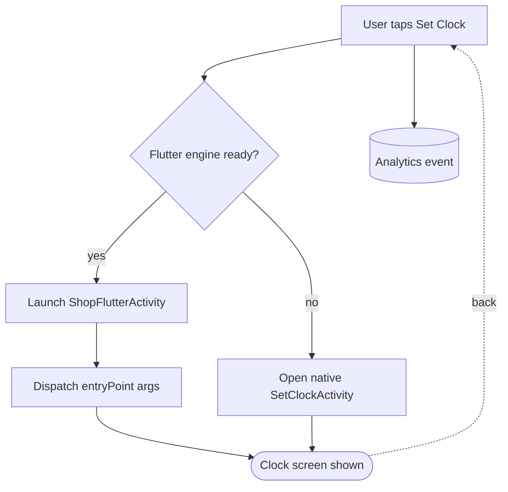

# Move Set Clock navigation to Flutter

## Overview
Route the **Set Clock** screen through the Flutter module instead of the native activity, keeping the native screen as a fallback when the Flutter engine isn't ready.

## Changes
1. `MainMenuActivity.kt`: replace the direct `startActivity` with `FlutterModule.launch(EntryPointConst.SET_CLOCK)`.
2. `EntryPointConst`: add `SET_CLOCK`.
3. Keep `SetClockActivity` as the fallback.

## Verification
- Tap **Set Clock** with the engine warm and cold.
- Back navigation returns to the menu.
